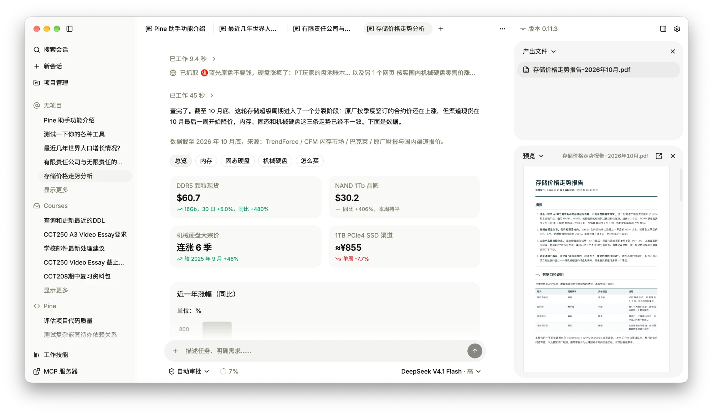

# Pine

[简体中文](./README.md) | **English**

An AI agent workspace built to give everyone more possibilities.



> [!CAUTION]
> Pine is currently an early developer preview. The interface, data formats, and agent behavior may change in incompatible ways. Don't use it for important data.

## Introduction

Most AI agent tools are made for developers: terminals, editor plugins, command-line flags. Pine is a desktop agent workspace for people who handle documents, spreadsheets, reports, and reference material every day:

- Files of all kinds preview right inside the workspace, and the agent operates on exactly the files you see.
- The agent's reads, tool calls, and file changes all appear in the session. Actions that need approval ask first, and you can stop at any time.
- Projects, sessions, and files are stored on your machine; you configure the model connection (API key / OAuth) yourself, and Pine doesn't relay it.

## Features

- Sessions are organized by project. One project can link several folders, each with its own read-only or read-write permission, and multiple sessions can run at the same time.
- Preview text and code, PDF, Office / iWork documents, data tables, images, audio and video, archives, email, e-books, charts, CAD drawings, 3D models, and more.
- The agent's local tools are confined to authorized folders, with permission modes ranging from approving each action to fully autonomous.
- Task lists, background processes, context compaction, image generation, web search and fetching.
- Supports Skills, MCP servers, and Computer Use.
- Many model providers built in, and custom providers and models are supported too.
- Use Pine in a browser, or pair other devices with a QR code / link and use the Pine on this computer remotely through Aldine, with no port forwarding and end-to-end encryption (Settings → Remote control).
- Chinese and English interface, light / dark themes, and an optional reading font.

macOS is supported, Windows is partially supported, and Linux is not yet supported.

## Install

Regular users should download the installer from [Releases](https://github.com/aldinelabs/pine/releases/latest). For detailed steps (installing, connecting a model, creating your first project), see the [getting-started guide](https://docs.aldine.cn/en/pine/getting-started/) (also available in [简体中文](https://docs.aldine.cn/zh/pine/getting-started/)).

## Run from source

Requires [Bun](https://bun.sh/); see `packageManager` in `package.json` for the exact version.

```bash
git clone https://github.com/aldinelabs/pine.git
cd pine
bun install --frozen-lockfile
bun run dev
```

On first launch, Windows prompts you to set up the Windows sandbox; allow it in the UAC prompt.

## Server deployment

Pine can also run without a window on a macOS or Linux server and be used only through a browser (needs a recent Node.js; Linux also needs bubblewrap, socat, and ripgrep, with the exact requirements in the deployment doc):

```bash
bun install --frozen-lockfile
bun run build:server
PINE_PASSWORD='at least 8 characters' node apps/desktop/.vite/server/server.mjs
```

It listens only on `127.0.0.1:9415` by default, and putting it behind a reverse proxy is recommended. All options, a systemd example, and the differences from the desktop app are in [Run on a server](https://docs.aldine.cn/en/pine/advanced/server/).

## Development

```bash
bun run dev     # start the dev environment
bun run check   # format, lint, type check, and unit tests
bun run build   # package
```

Architecture and design docs are in [`docs/`](./docs/) (Chinese), the release process is in [`docs/release.md`](./docs/release.md), and development conventions are in [`AGENTS.md`](./AGENTS.md). Issues and PRs are welcome; please run `bun run check` before submitting.

## License

[AGPL-3.0](./LICENSE)
