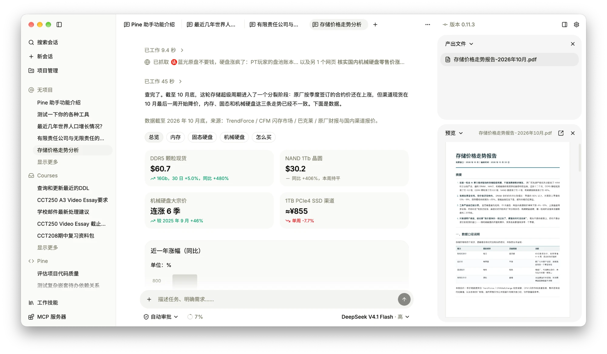

# Pine

致力于为所有人提供更多可能性的 AI 代理工作区。



> [!CAUTION]
> Pine 目前是早期开发者预览版，界面、数据格式和 Agent 行为都可能发生不兼容变更，请勿用于重要数据。

## 简介

多数 AI Agent 工具面向开发者：终端、编辑器插件、命令行参数。Pine 是一个桌面端 Agent 工作区，面向每天处理文档、表格、报表和资料的人：

- 各类文件在工作区内直接预览，Agent 操作的就是你看到的文件。
- Agent 的读取、工具调用和文件修改都显示在会话中，需要审批的操作会先询问，随时可以中止。
- 项目、会话和文件保存在本机；模型连接（API key / OAuth）由你自己配置，Pine 不做中转。

## 功能

- 按项目组织会话，一个项目可关联多个文件夹并分别设置只读 / 读写权限；多个会话可同时运行。
- 预览文本与代码、PDF、Office / iWork 文档、数据表格、图片、音视频、压缩包、邮件、电子书、图表、CAD 图纸和 3D 模型等。
- Agent 的本地工具限制在授权文件夹内，提供从逐一审批到完全自主的多档权限模式。
- 任务清单、后台进程、上下文压缩、图像生成、网页搜索与抓取。
- 支持 Skills、MCP 服务器和 Computer Use。
- 内置多家模型提供商，也可自定义提供商与模型。
- 中英文界面，浅色 / 深色主题。

macOS 已支持，Windows 部分支持，Linux 暂不支持。

## 从源码运行

需要 [Bun](https://bun.sh/)，版本以 `package.json` 的 `packageManager` 为准。

```bash
git clone https://github.com/aldinelabs/pine.git
cd pine
bun install --frozen-lockfile
bun run dev
```

Windows 首次使用 Agent 工具前，需在“设置 → 通用 → Windows 沙箱”中点击“安装”。

## 开发

```bash
bun run dev     # 启动开发环境
bun run check   # 格式、Lint、类型检查与单元测试
bun run build   # 打包
```

架构与设计文档在 [`docs/`](./docs/)，发布流程见 [`docs/release.md`](./docs/release.md)，开发约定见 [`AGENTS.md`](./AGENTS.md)。欢迎 Issue 和 PR，提交前请运行 `bun run check`。

## License

[AGPL-3.0](./LICENSE)
